<p align="center">
  <a href="https://www.scenario.com/"></a>
</p>
<h1 align="center">Scenario for Unity</h1>
<p align="center">
  <!-- x-release-please-start-version -->
  
  <!-- x-release-please-end -->
  
  
  <a href="LICENSE"></a>
  <a href="https://docs.scenario.com"></a>
  <a href="https://help.scenario.com"></a>
  <a href="https://mcp.scenario.com/docs"></a>
</p>

Every [Scenario](https://scenario.com) model inside the Unity Editor: images, video, 3D models, character animation, audio, PBR materials and skyboxes. A 3D model can then be retextured, edited with a prompt, remeshed, rigged, animated or split into parts without leaving Unity. Each request shows its price before anything is spent, and each result lands in the project as a wired Unity asset: a prefab on the ground at the Scene view pivot, a sprite on the selected renderer, a material on the selected mesh, an animated character with its Animator Controller, the scene's skybox. AI agents (Claude Code, Codex, Cursor, VS Code) drive the same actions through a local MCP server in the editor.

<picture>
  <source media="(prefers-color-scheme: dark)" srcset="docs/images/window-dark.png">
  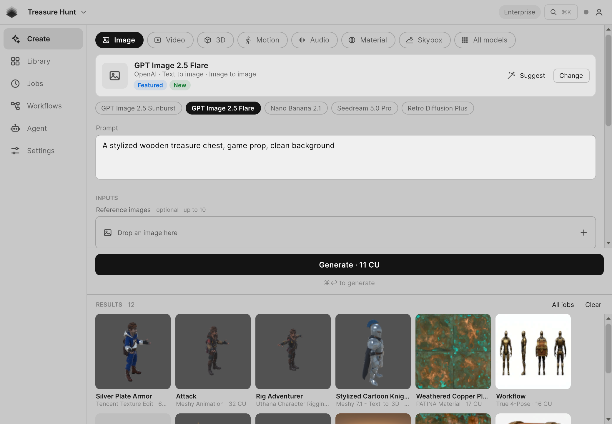
</picture>

## Made in Unity with the plugin

Every image below is a real Scenario result, imported by the plugin and rendered by Unity.

**Generate a 3D model** from a prompt or an image: Meshy 7.1, Rodin Gen-2.5, Hunyuan 3D 3.1 Pro, Tripo P2, Voxel Crafter and the rest of the catalog.

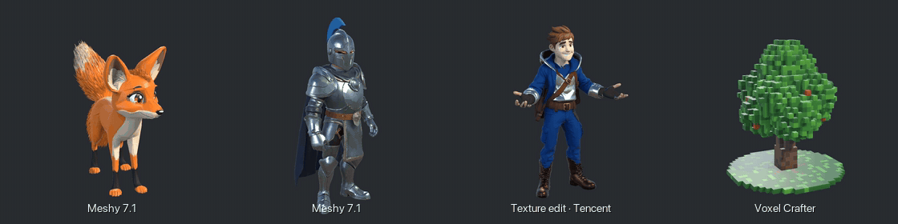

**Then work on it** with every 3D operation on Scenario. One chest, eight operations:

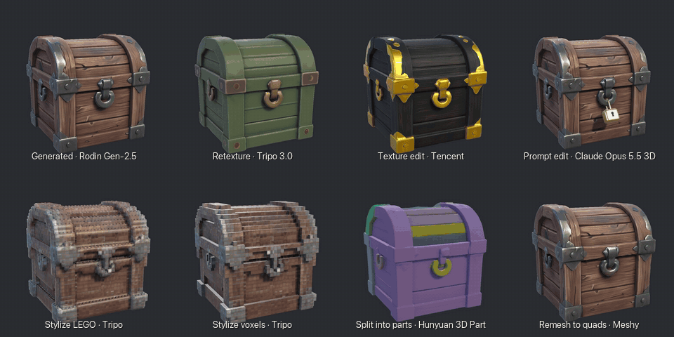

**Rig and animate it.** Rigging, Meshy's motion library (656 motions picked by name), motion from a prompt or from a video. The result arrives with an Animator Controller and plays in Play mode.

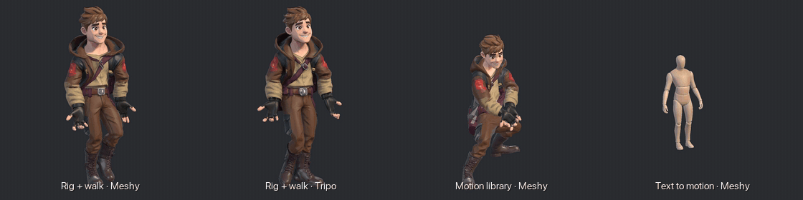

<table>
  <tr>
    <td width="45%">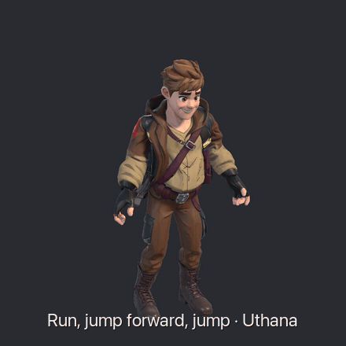</td>
    <td>
      <b>Text to motion.</b> The prompt <i>"runs forward fast, takes a big jump forward, lands and keeps running, then jumps high in the air"</i>, sent to Uthana Text to Motion 3.0 with the character on the left, returns an 8-second clip. The plugin imports the GLB, builds the Animator Controller and places the character. Cartwheel takes the same request. In this clip the hips are held over one spot so the jumps stay in frame.
    </td>
  </tr>
</table>

## Contents

[Install](#install) · [Sign in](#sign-in) · [Create](#create) · [3D: every operation](#3d-every-operation) · [Motion](#motion) · [Models](#find-a-model) · [Next steps](#next-steps) · [Library, Jobs, Workflows](#library-jobs-and-workflows) · [Agents (MCP)](#agents-mcp) · [Editor scripts and CI](#editor-scripts-and-ci) · [Spending rules](#spending-rules) · [Where files go](#where-files-go) · [Documentation](#documentation) · [Development](#development)

## Install

Unity 6.0 or later. Tested on Unity 6.3 (6000.3.21f1) on macOS, with URP and with the Built-in pipeline. Editor only: nothing from the package ships in a player build.

1. In Unity, open **Window > Package Management > Package Manager**, press **+** and choose **Install package from git URL**.
2. Paste:
   ```
   https://github.com/scenario-labs/unity-plugin.git?path=/Packages/com.scenario.unity
   ```
   Add `#unity-plugin-v0.2.0` at the end to pin a release. <!-- x-release-please-version --> The package pulls in glTFast (Unity's GLB importer) and Newtonsoft JSON.
3. Open **Window > Scenario** (Alt+Shift+S).

**Earlier plugin.** This package replaces the earlier Scenario plugin for Unity (`com.scenarioinc.scenario`, v0.11.0 and before), which is no longer maintained. Remove it in the Package Manager, then install this one. Its code stays on the [`legacy`](https://github.com/scenario-labs/unity-plugin/tree/legacy) branch and under its `v0.x` tags, so an old install pinned with `?path=/package#v0.11.0` still resolves.

## Sign in

- **Sign in with Scenario** opens your browser. Approve, go back to Unity, pick a team and a project: generations are billed to that project. Switch it later from the header.
- **Use an API key instead**: paste the key and secret from the Scenario web app (or `key:secret` in one go). The key is tied to one project.
- **CI and batch mode**: set `SCENARIO_API_KEY` and `SCENARIO_API_SECRET`.

Secrets never go into the Unity project, so nothing reaches git: they live in the macOS Keychain or the Windows Credential Manager (entry "Scenario Unity Plugin"), or elsewhere in a file readable by your user only.

## Create

Pick a type, a model and a prompt. The settings form is built from the model's live schema, essentials first, and the **Generate** button carries the price of exactly this request.

<table>
  <tr>
    <td width="33%"><picture><source media="(prefers-color-scheme: dark)" srcset="docs/images/screens/create-3d-dark.png">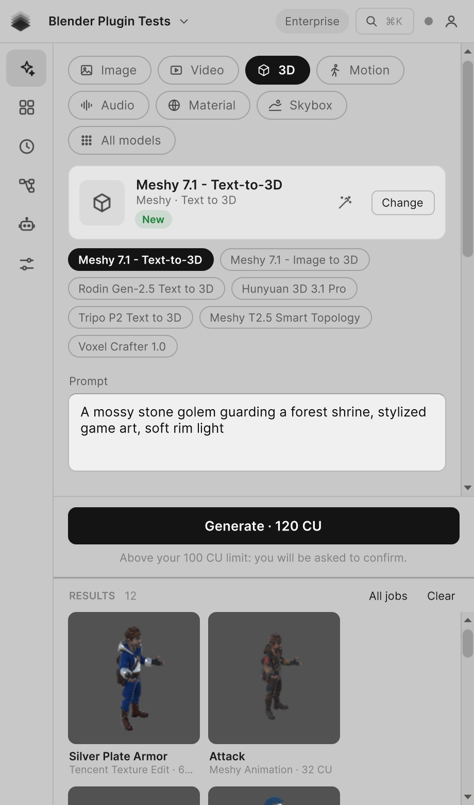</picture></td>
    <td width="33%"><picture><source media="(prefers-color-scheme: dark)" srcset="docs/images/screens/create-material-dark.png">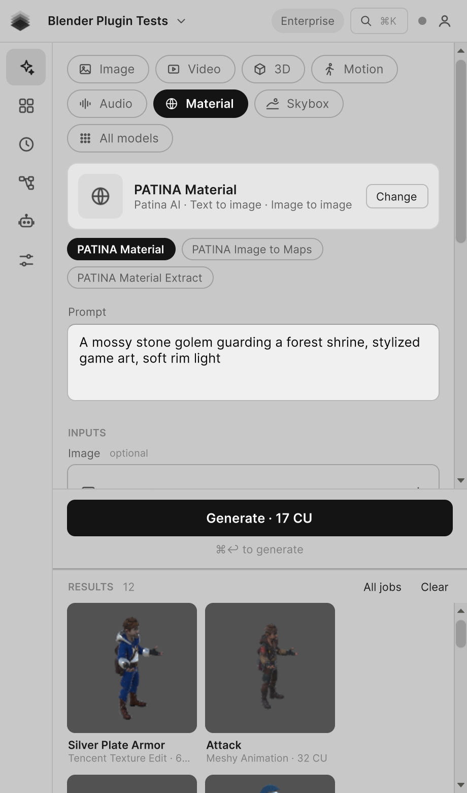</picture></td>
    <td width="33%"><picture><source media="(prefers-color-scheme: dark)" srcset="docs/images/screens/create-skybox-dark.png">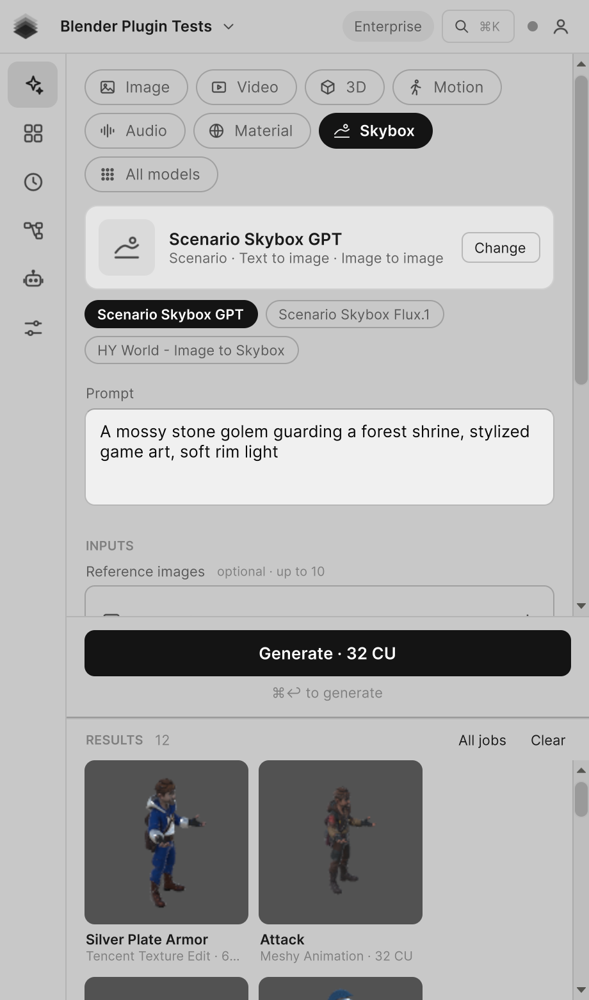</picture></td>
  </tr>
  <tr>
    <td align="center">3D</td><td align="center">Material</td><td align="center">Skybox</td>
  </tr>
</table>

| Type | Quick picks (the whole catalog is one click away) | Lands in Unity as |
|---|---|---|
| Image | GPT Image 2.5 Sunburst, GPT Image 2.5 Flare, Nano Banana 2.1, Seedream 5.0 Pro, Retro Diffusion Plus | a texture or sprite, set on the selected SpriteRenderer, UI Image, RawImage or renderer, or a new quad or sprite |
| Video | Minimax H3, Gemini Omni 1.1 Flash, Wan 3.0, Seedance 2.5 | a VideoClip on the selected VideoPlayer, or a new screen quad |
| 3D | Meshy 7.1, Rodin Gen-2.5, Hunyuan 3D 3.1 Pro, Tripo P2, Meshy T2.5 Smart Topology, Voxel Crafter | a GLB imported as a prefab, placed on the ground at the Scene view pivot, optional MeshCollider |
| Motion | Cartwheel and Uthana text to motion, Meshy Text to Motion, Meshy Animation, Cartwheel and Uthana video to motion | an animated GLB with an Animator Controller, one state per clip |
| Audio | Mirelo SFX 2.0, ElevenLabs Sound Effects 2, Sonilo V1.1, ElevenLabs Music v2.5, Gemini 3.8 Flash TTS | an AudioClip on the selected AudioSource, or a new one |
| Material | PATINA Material, PATINA Image to Maps, PATINA Material Extract | a material for the active pipeline (Built-in, URP, HDRP) with normal, height and packed metallic and smoothness maps, set on the selected renderers |
| Skybox | Scenario Skybox GPT, Scenario Skybox Flux, HY World Image to Skybox | a Skybox/Panoramic material set as the scene's skybox |
| All models | every model in the catalog, plus your team's own | by the kind of file it returns |

Inputs (reference images, a start frame, a 3D model, a video, a voice) are filled by dragging from the Project window or the Hierarchy, or from the slot's menu: the selection, a capture of the Scene view or the main camera, a file, a Scenario asset. Unity files are uploaded once, free. Each result shows as a card with **Place**, **Next** (the typed steps for it) and **More**.

## 3D: every operation

A generated or imported model opens the 3D steps, grouped in the **Next** menu. Each step opens Create with its default model and the model already attached, so the price shows before anything is sent; the other models of the step are one click away.

<table>
  <tr>
    <td width="33%"><picture><source media="(prefers-color-scheme: dark)" srcset="docs/images/screens/step-retexture-dark.png">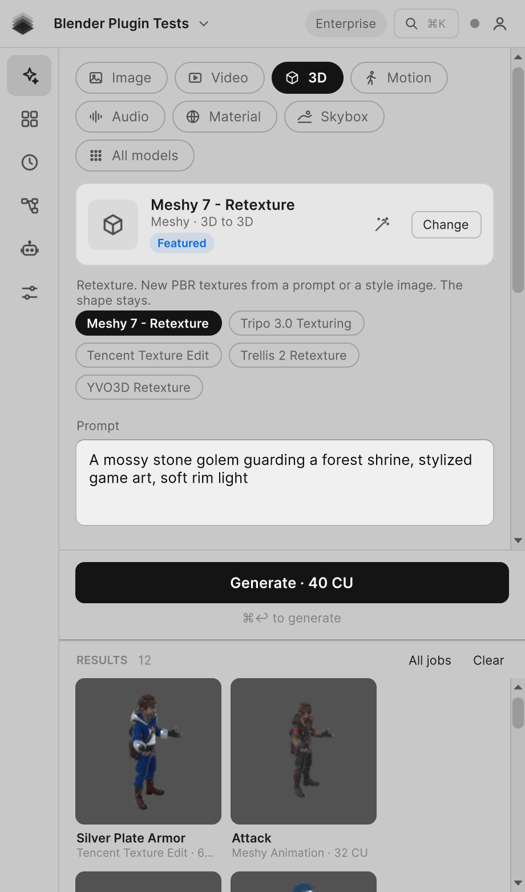</picture></td>
    <td width="33%"><picture><source media="(prefers-color-scheme: dark)" srcset="docs/images/screens/step-remesh-dark.png">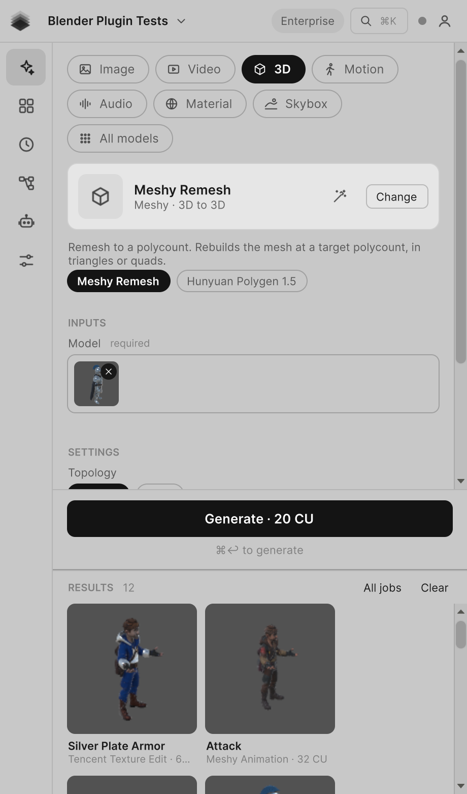</picture></td>
    <td width="33%"><picture><source media="(prefers-color-scheme: dark)" srcset="docs/images/screens/step-rig-dark.png">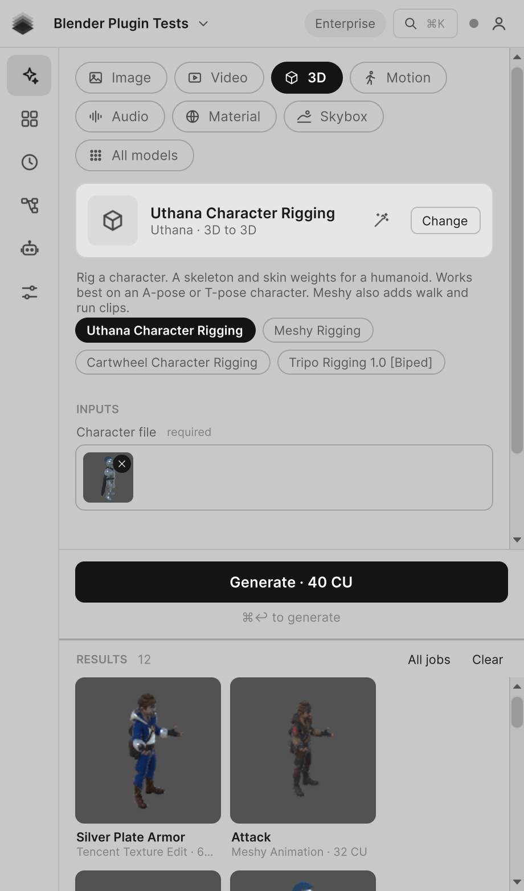</picture></td>
  </tr>
  <tr>
    <td align="center">Retexture</td><td align="center">Remesh to a polycount</td><td align="center">Rig a character</td>
  </tr>
</table>

| Group | Step | Models (default first) |
|---|---|---|
| Texture | Retexture | Meshy 7 Retexture, Tripo 3.0 Texturing, Tencent Texture Edit, Trellis 2, YVO3D |
| | UV unwrap | Tripo Smart UV, Meshy UV Unwrap, Tencent |
| Shape | Edit with a prompt | Claude Opus 5.5 3D, Astra 3D |
| | Retopology | Tripo Retopology v3, Hunyuan Polygen |
| | Remesh to a polycount | Meshy Remesh, Hunyuan Polygen |
| | Refine the shape from an image | UltraShape |
| Rig and animate | Rig a character | Uthana, Meshy, Cartwheel, Tripo |
| | Rig a creature | Tripo Rigging 2.5 |
| | Animate from the motion library | Meshy Animation, Tripo |
| | Animate from a prompt | Cartwheel, Uthana, Astra |
| | Animate from a video | Cartwheel, Uthana |
| Parts and style | Split into parts | Tripo Segmentation v2, Hunyuan 3D Part, Hitem3D Split, Rodin Bang |
| | Stylize as LEGO, voxels or Voronoi | Tripo Stylization, Hitem3D Multicolor |

What the plugin handles so the result just works in Unity:

- **One model per result.** A rig delivered with walk and run files becomes one character with every clip in its controller; the bare-skeleton copies are skipped.
- **Formats.** Results Scenario stores as FBX, Blender or VOX files arrive as GLB, skins and animations included. Inputs that only read FBX (Tencent Texture Edit) get Scenario's FBX copy of your model, free.
- **Scale and materials.** A rig written in centimeters is placed at 1% scale. Meshes without a material keep their vertex colors (Hitem3D Multicolor, Hunyuan 3D Part).
- **Gaussian splats** (TripoSplat, HY World, Marble) are saved as `.ply` or `.spz` files, ready for a splat renderer package.

## Motion

Motion gathers the animation models: a motion from a prompt (Cartwheel, Uthana, Meshy), from a video (Cartwheel, Uthana), or from Meshy's library applied to your character. The library's 656 motions are picked by name, with a search and category chips, instead of a numeric id.

<table>
  <tr>
    <td width="33%"><picture><source media="(prefers-color-scheme: dark)" srcset="docs/images/screens/create-motion-dark.png">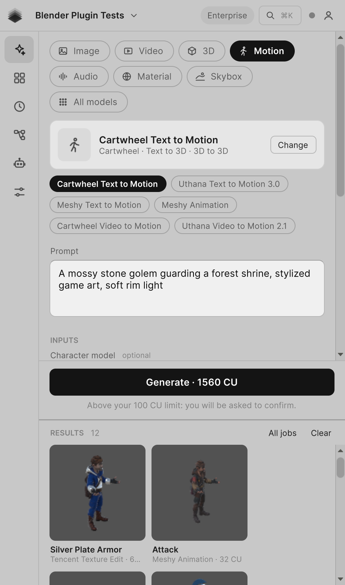</picture></td>
    <td width="33%"><picture><source media="(prefers-color-scheme: dark)" srcset="docs/images/screens/motion-picker-dark.png">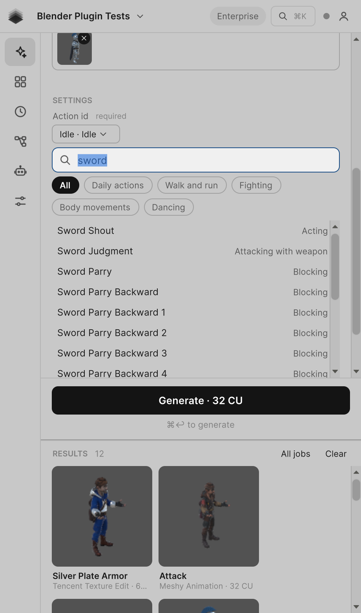</picture></td>
    <td width="33%"><picture><source media="(prefers-color-scheme: dark)" srcset="docs/images/screens/step-image-to-3d-dark.png">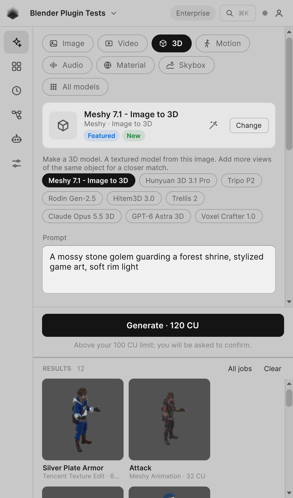</picture></td>
  </tr>
  <tr>
    <td align="center">Text to motion</td><td align="center">Motion library by name</td><td align="center">Image to 3D step</td>
  </tr>
</table>

## Find a model

**Suggest** sends your prompt to Scenario's recommender and ranks the best models for the type. **Change** opens the model browser: search, favorites, your team's trained models, legacy models on demand. **Ctrl+K** (Cmd+K) opens a command palette over models, views, actions and the selection's steps, with **Ask Claude** for anything else.

<table>
  <tr>
    <td width="50%"><picture><source media="(prefers-color-scheme: dark)" srcset="docs/images/screens/model-browser-dark.png">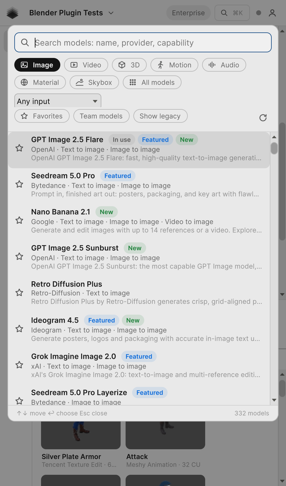</picture></td>
    <td width="50%"><picture><source media="(prefers-color-scheme: dark)" srcset="docs/images/screens/command-palette-dark.png">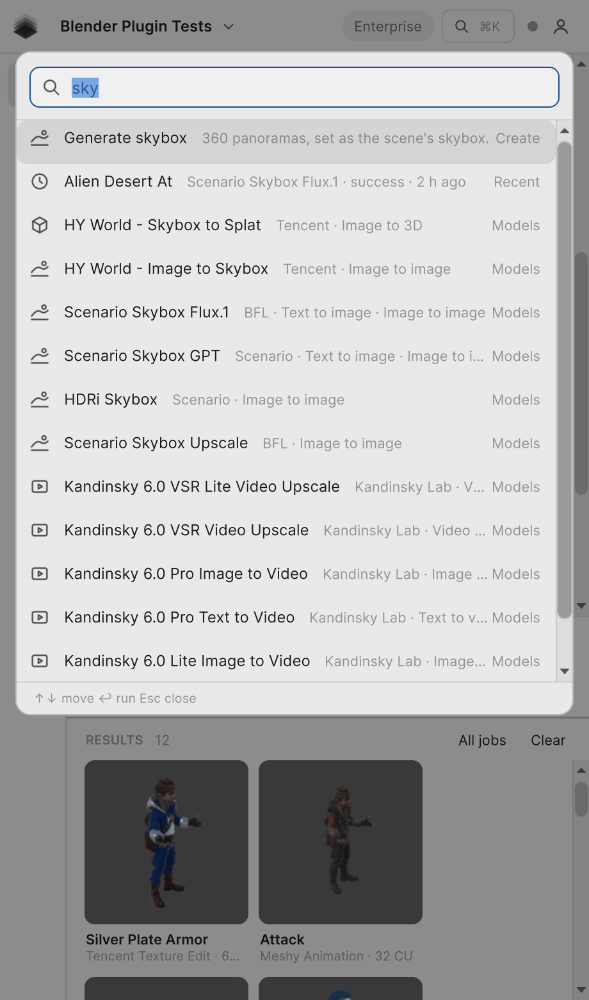</picture></td>
  </tr>
</table>

## Next steps

Any asset leads to the next one. An image becomes a 3D model, a Gaussian splat, a video, a PBR material, a skybox or a cleaner image (remove background, upscale, vectorize, pixelate, edit by prompt). A video becomes an upscaled or restyled one, one with sound, or a character animation. A voice becomes a changed or isolated one. Steps are on result cards, on a right-click in the Project window or the Hierarchy (**Scenario > Next Step**) and in the Inspector header of any generated asset, which also shows its model, prompt, job and cost.

**In the Scene view**, the Scenario panel follows the selection. A placed model gets its steps (Texture, Shape, Rig and animate, Parts and style) and scene actions that run at once: **Make playable** for a rigged character with a walk, **Put on the ground**, **Set** a height in meters, **Make walkable** for a bridge or platform. A terrain gets **Scatter here** (a model, a count, an area) and **Light and mood** presets. An image or a sprite gets the image steps; nothing selected, the Generate shortcuts. Steps open Create with the asset attached and show the price before anything is sent.

## Library, Jobs and Workflows

<table>
  <tr>
    <td width="33%"><picture><source media="(prefers-color-scheme: dark)" srcset="docs/images/screens/library-dark.png">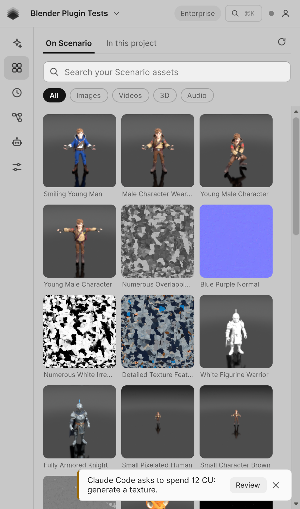</picture></td>
    <td width="33%"><picture><source media="(prefers-color-scheme: dark)" srcset="docs/images/screens/jobs-dark.png">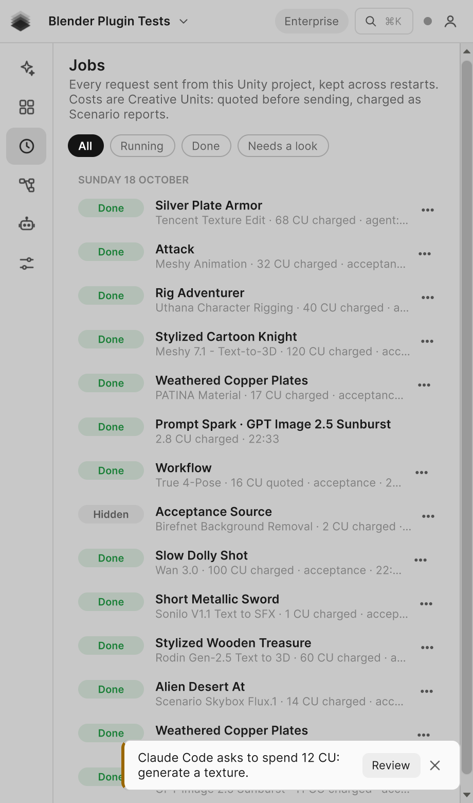</picture></td>
    <td width="33%"><picture><source media="(prefers-color-scheme: dark)" srcset="docs/images/screens/workflows-dark.png">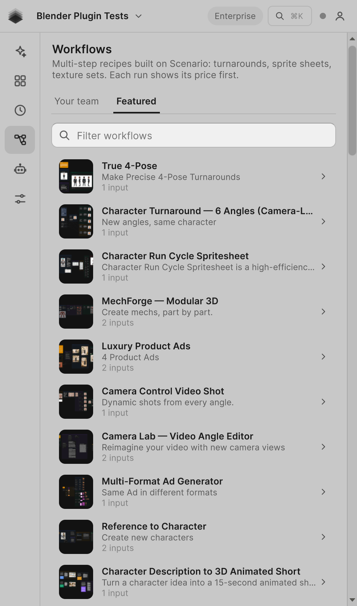</picture></td>
  </tr>
  <tr>
    <td align="center">Library</td><td align="center">Jobs</td><td align="center">Workflows</td>
  </tr>
</table>

- **Library** browses your Scenario project's assets and imports any of them. Its second tab lists every asset in this Unity project that came from Scenario, so a lead can audit what was generated.
- **Jobs** keeps every generation on your machine, across restarts and recompiles. A job whose connection dropped while sending shows as Unknown and blocks the same request until it is matched on Scenario, so a network error cannot charge you twice.
- **Workflows** lists your team's Scenario workflows and the featured public ones; their inputs become a form with a price.

## Agents (MCP)

Turn on **Agent** in the window and the editor serves an MCP server named `scenario-unity` on `http://127.0.0.1:8791/mcp`, with a bearer token kept on your machine. The Agent view gives the setup for Claude Code (and runs it), Codex, Cursor and VS Code.

<table>
  <tr>
    <td width="40%"><picture><source media="(prefers-color-scheme: dark)" srcset="docs/images/screens/agent-dark.png">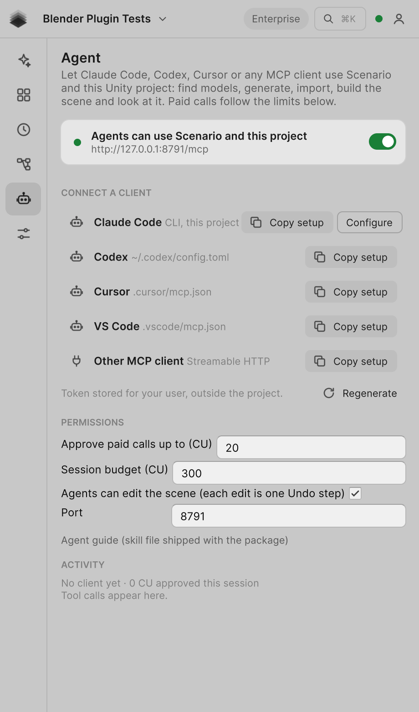</picture></td>
    <td>

The agent gets three sets of tools:

- **Scenario**: find a model, find a motion in Meshy's library, price, generate, run workflows, follow jobs, import, upload.
- **Scene**: inspect the hierarchy, create and change objects and components, size them in meters and sit them on the ground, assign materials, set the skybox, save, read the console, and capture the Scene view or the main camera as an image it can look at.
- **World**: build a terrain from a generated heightmap with ground materials painted by height and slope, measure the ground along a route, scatter models on it with colliders or line them up along a path with lights, make a generated bridge or platform walkable (invisible walkway, rails, ramps to the ground), set the light and mood from a preset (sun, fog, ambient, URP post-processing), capture four angles at once, turn a rigged and animated character into a third-person player with a follow camera, and playtest in Play mode (the character walks, runs and jumps through waypoints; the result says what it reached and whether it fell) or record frames.

Every scene edit is one Undo step. A paid call above the per-call limit (80 CU by default) or beyond the session budget (1,200 CU) waits for **Approve** in the window. The activity log lists every call.

Example, tested with Claude Code: *"Check that you are signed in, find a sword attack in the motion library, list three image-to-3D models, price a barrel prop, add a cube to the scene and show me the Scene view."* It ran the six steps in 17 seconds without spending. The barrel's price, 120 CU, is above the auto-approve limit, so generating it would wait for approval in Unity.

**Ask from inside Unity.** Type a request in the **Ask** field of the Scene view panel or the Agent view ("make the bridge rustier", "add 20 pines around the temple"). The plugin runs your Claude Code against the bridge with the selection, and shows each tool call, the answer and any approval it waits for; **Stop** ends it. The command palette has **Ask Claude** too. It needs Claude Code installed and signed in; everything else works without it.

The hosted [Scenario MCP](https://mcp.scenario.com/docs) covers the platform without Unity (collections, training, usage). Connect both when needed.

</td>
  </tr>
</table>

## Editor scripts and CI

```csharp
using Newtonsoft.Json.Linq;
using Scenario;

var parameters = new JObject { ["prompt"] = "A rune stone icon, flat colors" };
var cu = await ScenarioApi.Estimate("model_openai-gpt-image-2-5-flare", parameters);      // free
var result = await ScenarioApi.Generate("model_openai-gpt-image-2-5-flare", parameters, maxCu: 20);
Debug.Log(string.Join(", ", result.Files)); // Unity asset paths
```

`Generate` prices first and refuses, without sending, anything above `maxCu`. In batch mode, set `SCENARIO_UNITY_SERVICE=1` so jobs are polled and imported.

## Spending rules

- **Price first.** The button reads `Generate · 11 CU`, from a free price check of the exact request. Change anything and the price is checked again.
- **One click, one paid request.** Each price is used once, and a paid request is never retried.
- **Uncertain means Unknown.** If the connection drops while a paid request is being sent, the job is marked Unknown and the same request waits until it is matched on Scenario.
- **Confirmation** above a threshold (1,000 CU by default, in Settings).
- **Spending switch** in Settings, or `SCENARIO_NO_SPEND=1` for the whole editor. Price checks, browsing and imports still work.
- Moderated requests show as Blocked and are never resent.

<picture>
  <source media="(prefers-color-scheme: dark)" srcset="docs/images/screens/settings-dark.png">
  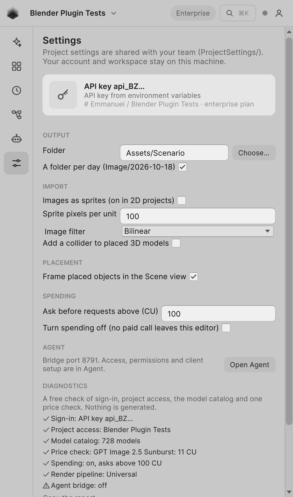
</picture>

## Where files go

Results go to `Assets/Scenario/<Type>/<date>/`, named after the prompt, for example `Assets/Scenario/Models/2026-10-18/a-stylized-wooden-treasure-chest-83pjsb.glb`. Each asset records its model, prompt, job, settings and cost in its `.meta` file, carries the `Scenario` label and shows them in the Inspector. Every placement is one Undo step. The job list lives in `Library/Scenario/jobs.json`, on your machine only.

Project settings (output folder, import, placement, spending threshold) are saved in `ProjectSettings/` and shared with your team. Your account, favorites, spending switch and agent settings stay on your machine. **Settings > Diagnostics** runs a free check of sign-in, project access, the catalog and one price check, and copies a report for support.

<br clear="right">

## Documentation

- [User guide](Packages/com.scenario.unity/Documentation~/USER_GUIDE.md): every view step by step, job states, troubleshooting.
- [Agent skill](Packages/com.scenario.unity/Documentation~/agent-skill/SKILL.md): what an agent should know to use the bridge well.
- [Changelog](Packages/com.scenario.unity/CHANGELOG.md), [roadmap](ROADMAP.md), [support](SUPPORT.md), [security](SECURITY.md).

## Development

The repository root is a Unity 6.3 project that hosts the package (`Packages/com.scenario.unity`) and its tests; [AGENTS.md](AGENTS.md) has the code map and rules. Run the EditMode tests from the Test Runner window, or in batch mode:

```sh
Unity -batchmode -projectPath . -runTests -testPlatform EditMode -testResults results.xml
```

The window tests need a graphics device and are skipped under `-nographics`. Live checks run from `Assets/ScenarioDev/Editor` with `-executeMethod` and the test key in `SCENARIO_API_KEY` and `SCENARIO_API_SECRET`:

- `ScenarioDev.ContractCheck.Run` (free, needs `SCENARIO_NO_SPEND=1`) prices every quick pick, every 3D step and a set of workflows.
- `ScenarioDev.Acceptance.Run` (paid, needs `SCENARIO_ACCEPT=1`) runs one generation per type and records it in `tests/live/LEDGER.md`.
- `ScenarioDev.Accept3D.Import` (free) imports one real result of each 3D operation and checks the model, its rig and its clips, with a render of each; `ScenarioDev.Accept3D.Paid` sends a few 3D operations through the window's and the agent's paths.
- `ScenarioDev.E2E.OAuth` checks the browser sign-in (a person signs in); `ScenarioDev.E2E.Agent` with `tools/e2e_agent.py` has Claude Code drive the editor through the agent bridge.
- `ScenarioDev.Media.Run` renders the turntables and animations above, and `tools/build_media.py` turns them into the GIFs.

## License

[MIT](LICENSE). Scenario is a trademark of Scenario Inc.
