# Scenario for Unity: user guide

Scenario for Unity adds a window to the Unity Editor that runs Scenario's models on your project: images, video, 3D models, character animation, audio, PBR materials and skyboxes. Each result lands as a working Unity asset, a prefab on the ground, a material on your mesh, a character that moves in Play mode, the scene's sky, and every request shows its price before anything is spent. You need Unity 6.0 or later and a Scenario account.

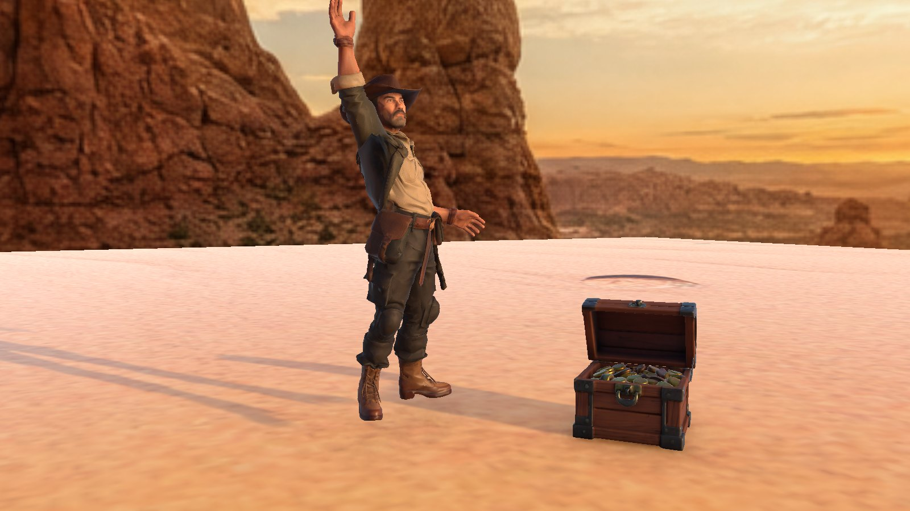

> Every picture in this guide is a real Scenario result, imported by the plugin and rendered by Unity.

## How it works

The window reads what you have selected, offers the steps that fit it, and lands each result in the project as a Unity asset.

### Four words used on this page

- **CU**: Compute Units, what Scenario charges. The **Generate** button shows the price of the exact request, for example `Generate · 120 CU`.
- **Step**: an action that turns one asset into the next: retexture a model, rig a character, animate it, upscale an image. A step opens Create with the model and the asset already attached.
- **Job**: one request sent to Scenario. The **Jobs** view follows it from Sending to Done and keeps it across restarts.
- **Place**: put a result in the open scene. Without it, the result is only imported into the project.

### The window follows your selection

There is no mode to switch. Select something in the Scene view, the Hierarchy or the Project window, and the **Scenario** panel in the Scene view offers what fits it:

| Selected | The panel offers |
| --- | --- |
| A 3D object in the scene | Its steps (Texture, Shape, Rig and animate, Parts and style), then **Make playable**, **Put on the ground**, **Height** and **Make walkable** |
| A terrain | **Scatter here** and **Light and mood** |
| An image, a texture or a sprite | Edit, remove the background, upscale, make a 3D model, a material, a skybox, a video |
| A video or a sound | Upscale, add sound, restyle; change or isolate a voice |
| Nothing | **Generate** an image, a 3D model, a material, a skybox or a sound; **Light and mood** |

The same steps are on each result card (**Next**), in a right-click in the Project window or the Hierarchy (**Scenario > Next Step…**), in the Inspector of a generated asset and in the command palette (Ctrl+K, Cmd+K on macOS).

## The example

The five steps below follow one character: a treasure hunter, made from a prompt, given a new outfit, rigged, animated three ways, and set in a desert scene with a chest of gold, sand and a canyon sky, the picture at the top of this page.

Each step pairs what you do in Unity with a Scenario model. Every picture is a real run with the plugin, at the models and prices the window showed.

## Generate a 3D model

**When to use it:** you need a prop, a character or a creature, and you have a prompt or a picture.

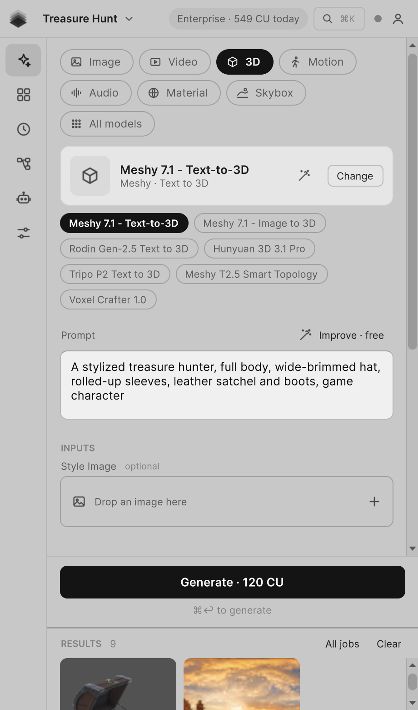

1. Open **Window > Scenario** (Alt+Shift+S) and choose **3D**. The model card shows the current model; the quick picks under it are the usual choices: Meshy 7.1, Rodin Gen-2.5, Hunyuan 3D 3.1 Pro, Tripo P2, Voxel Crafter.
2. Type what you want: "A stylized treasure hunter, full body, wide-brimmed hat, rolled-up sleeves, leather satchel and boots, game character". The button shows the price of exactly this request, checked for free. Above your confirmation limit, Unity asks before sending.
3. Click **Generate**, or press Ctrl+Enter (Cmd+Enter). The card follows the job, then the model lands as a prefab on the ground at the Scene view's pivot, or next to the object you selected.

For a character you will rig, set **Pose mode** to A-pose under **More settings**. Meshy 7.1 makes a 30,000-triangle game mesh by default, for the same price as its full detail of about a million; for the full mesh, turn off **Should remesh**.

### From a picture instead

Select an image in the Project window and choose **Make a 3D model**. It opens Meshy 7.1 Image to 3D with the image attached; Hunyuan 3D, Tripo P2, Rodin and others are one click away.

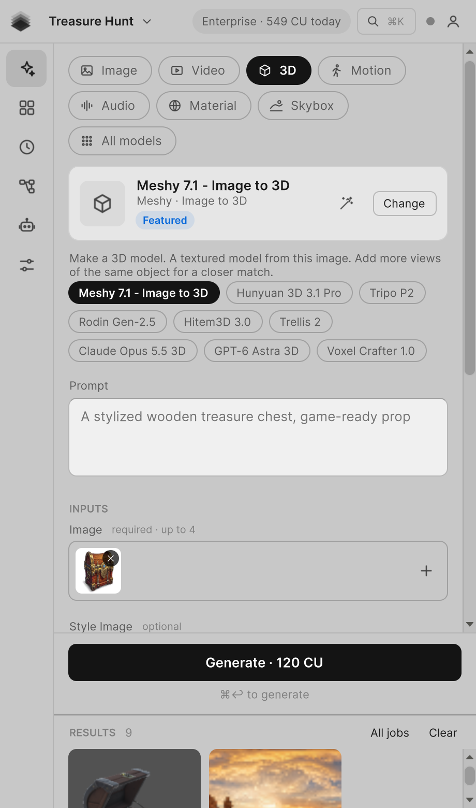

## Give it a new look

**When to use it:** the model is close but needs other materials, a lighter mesh, or parts you can move.

Select the hunter in the scene. The panel lists its steps in four groups. Each opens Create with its default model and your model attached, so you see the price before anything is sent.

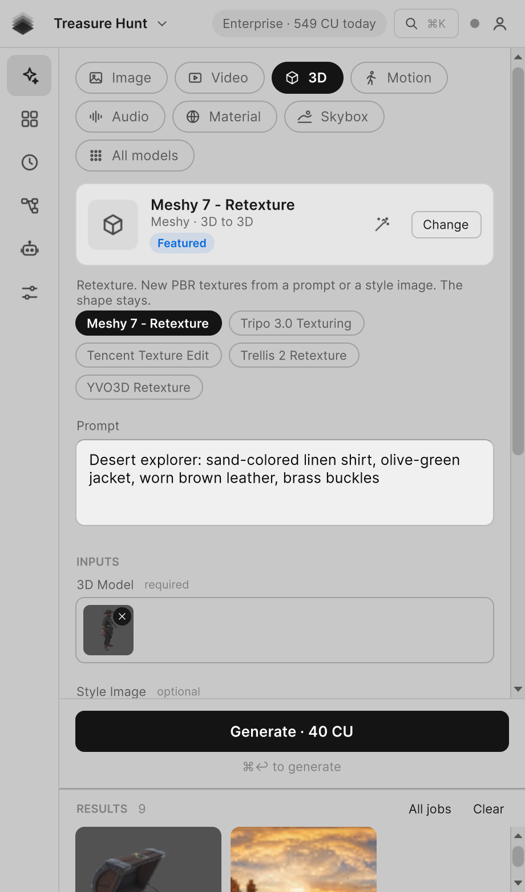

1. Choose **Texture > Retexture**. Meshy 7 Retexture opens with the hunter in its slot.
2. Describe the new materials: "Desert explorer: sand-colored linen shirt, olive-green jacket, worn brown leather, brass buckles". A picture works too, under **Style image**.
3. Click **Generate**. The new hunter lands next to the first one; the shape stays, the materials change.

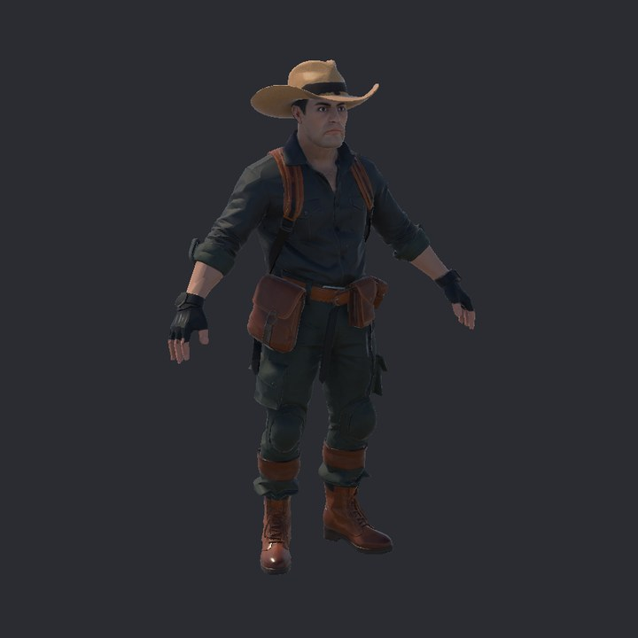 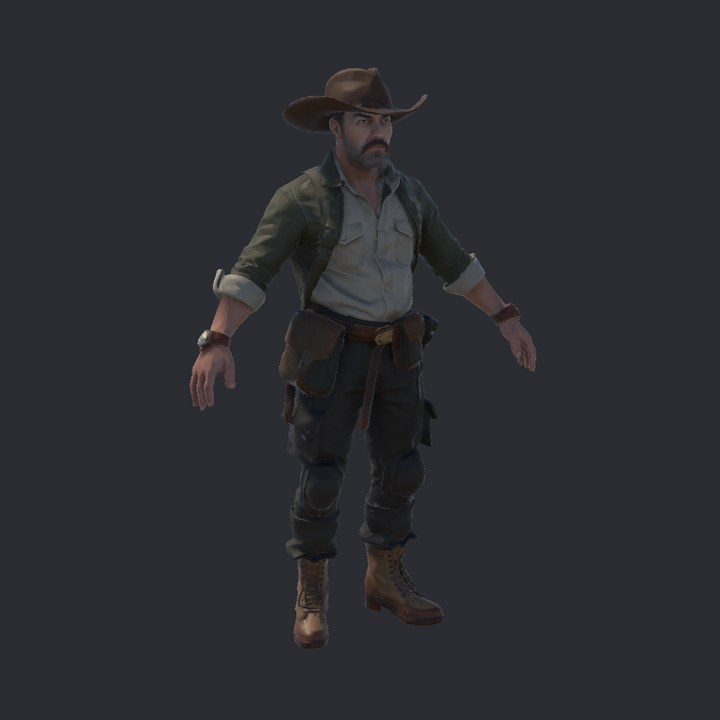

### Every other operation

The other groups work the same way. Here on a chest, one model and seven operations:

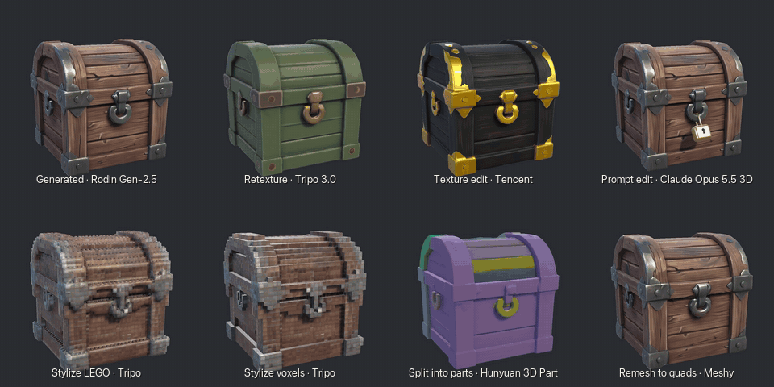

| Group | Steps |
| --- | --- |
| Texture | Retexture with a prompt or a picture; UV unwrap |
| Shape | Edit with a prompt; retopology; remesh to a polycount; refine the shape from an image |
| Rig and animate | Rig a character or a creature; animate from the motion library, a prompt or a video |
| Parts and style | Split into parts; stylize as LEGO, voxels or Voronoi |

The result replaces nothing: it lands next to the original as a new asset, and every placement is one Undo step.

## Rig and animate the character

**When to use it:** you have a character and want it to move.

### Rig it

Select the retextured hunter and choose **Rig and animate > Rig a character**. Uthana Character Rigging is the default. For the hunter we picked **Meshy Rigging**, one click away in the model card, because it also returns a walk and a run.

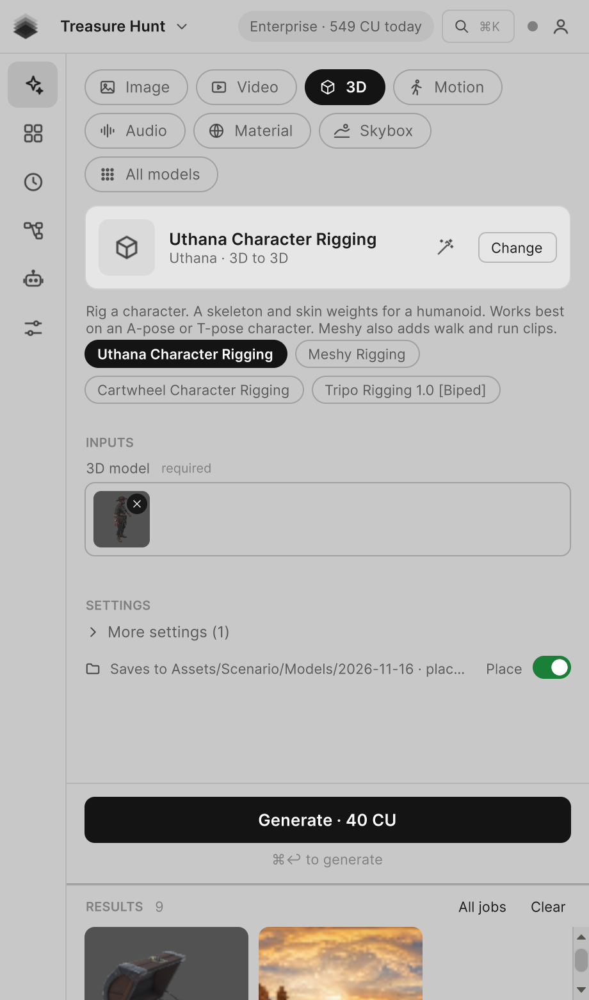

### Animate it

Three ways, from the same **Rig and animate** group or from **Motion** in Create:

- **From the motion library**: Meshy's 656 motions (walks, runs, fights, dances, daily actions), picked by name with a search and category chips. The hunter got "Victory Cheer".
- **From a prompt**: describe the motion. Cartwheel and Uthana take your character with it. The hunter got Uthana Text to Motion 3.0 with "Looks around, kneels and digs in the sand with both hands, then stands up and lifts something high above the head".
- **From a video**: Cartwheel and Uthana follow the movement of a person in a clip.

| Motion library | Motion from a prompt |
| --- | --- |
| 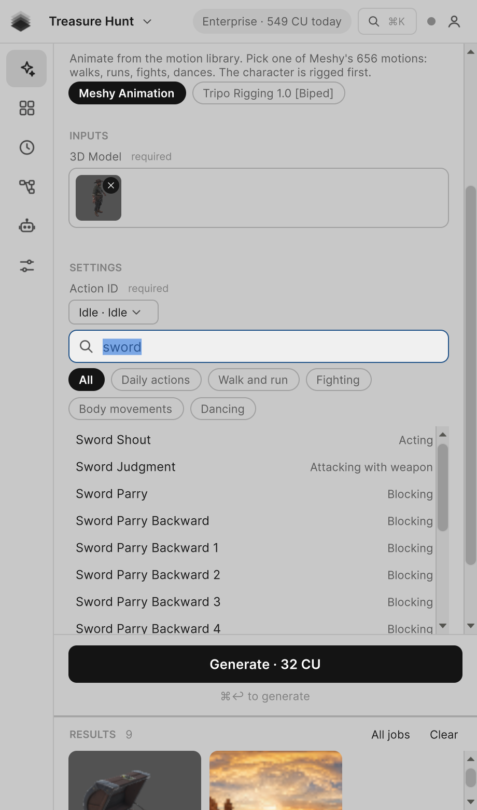 | 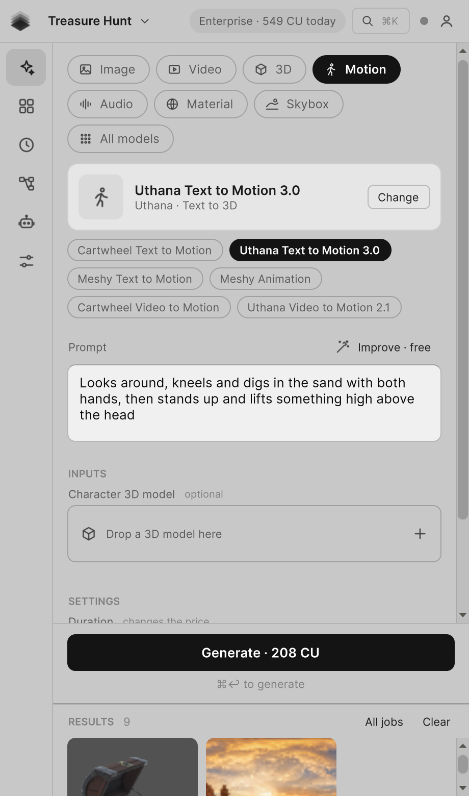 |

Each result arrives with an Animator Controller, one state per clip, and plays in Play mode.

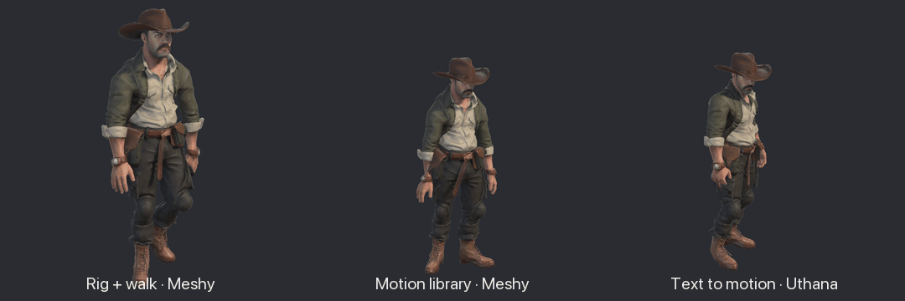

Check a motion before you build on it. In the digging clip the hat is not tied to the head, so it slides off when the hunter kneels.

### Make it playable

Select a rigged character with a walk and choose **Make playable** in the panel. Unity adds a character controller, an Animator Controller blending idle, walk and run, a jump and a follow camera. Press Play, then WASD to move, Shift to run, Space to jump. When the character is not ready, one line says what is missing, for example "No skeleton: rig it first".

## Dress the scene

**When to use it:** the scene needs props, materials, a sky, sound or a mood.

The hunter's scene took three more generations and one free preset:

- **A chest**: Rodin Gen-2.5 from "An open wooden treasure chest overflowing with gold coins, iron bands, stylized game prop".
- **The sand**: with the ground plane selected, **Material** and PATINA Material from "Fine desert sand with small pebbles and soft wind ripples". The material lands on the selected mesh, built for the project's render pipeline.
- **The sky**: **Skybox** and Scenario Skybox GPT from "A desert canyon at golden hour, red rock arches, warm hazy sky, distant dunes". It becomes the scene's sky.
- **The light**: **Light and mood > Golden hour**, which sets the sun, fog, ambient light and, in URP, post-processing. It is free and runs at once.

| Material | Skybox |
| --- | --- |
| 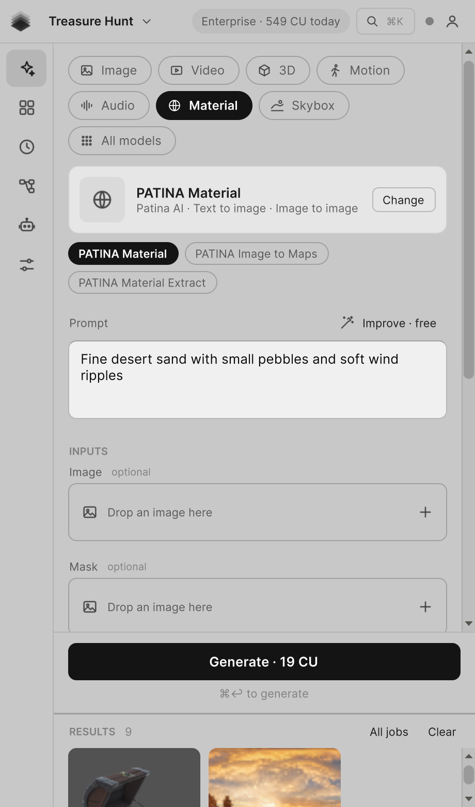 | 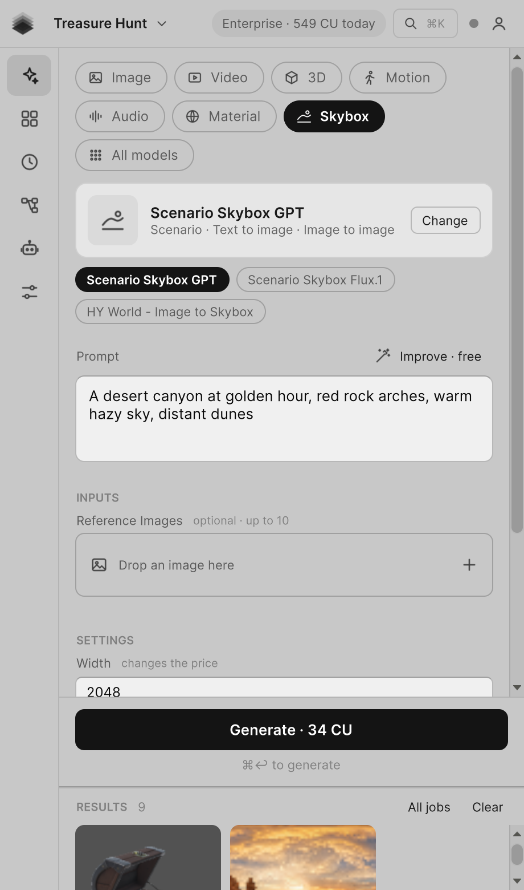 |

Also in the panel and in Create:

- **Audio**: sound effects, music or a voice, on the selected AudioSource or a new one.
- **Video**: a clip on the selected VideoPlayer or on a new screen.
- **Scatter here**, on a terrain: copies of a prefab around the view's center, sat on the ground. Each run gives a new arrangement; one Undo removes it.
- **Make walkable**, on a bridge, stairs or a platform: an invisible walkway on its deck, side rails and ramps to the ground.
- **Light and mood** presets: Golden hour, Midday, Overcast, Misty morning, Sunset, Night.

## Hand it to an agent

**When to use it:** you would rather say what you want than click through it, or you want an agent to build a whole scene.

Open **Agent** and turn on **Agents can use Scenario and this project**. Unity then lets Claude Code, Codex, Cursor, VS Code or any MCP client use the same models, prices and import rules as you, on this machine only.

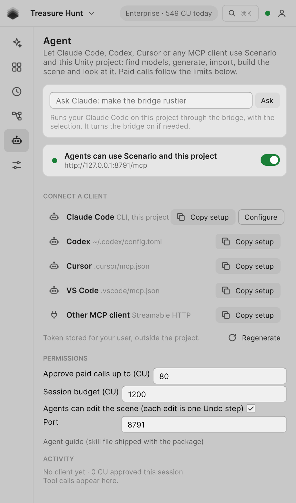

1. Click **Copy setup** for your client and paste it where the line says. For Claude Code, **Configure** does it for this project.
2. Ask. The agent can generate, import, place, scatter, rig and animate, set the light and mood, make a character playable and playtest it.

### Ask Claude from Unity

Type a request in the **Ask** field, at the top of the Agent view or of the Scenario panel, and press Enter: "make the bridge rustier", "add 20 pines around the temple", "rig and animate the selected character". The request goes with what you selected. Each tool call shows as one line; **Stop** ends the request.

Ask runs Claude Code, installed and signed in on this machine. Without it, everything else in the window works as before.

### Where you approve

- **Approve paid calls up to**: 80 CU per call by default. 0 asks every time.
- **Session budget**: 1,200 CU by default, since Unity started.
- Anything above either waits for **Approve** or **Deny**, and is refused after two minutes without an answer.
- **Agents can edit the scene** on or off. Each edit is one Undo step.

## Install

Unity 6.0 or later, with the Built-in render pipeline, URP or HDRP. Tested on Unity 6.3 on macOS. The package works in the editor only: nothing from it ships in a player build.

### From the Package Manager

1. In Unity, open **Window > Package Management > Package Manager**, click **+** and choose **Install package from git URL**.
2. Paste `https://github.com/scenario-labs/unity-plugin.git?path=/Packages/com.scenario.unity`
3. Open **Window > Scenario**, or press Alt+Shift+S.

### From the tarball, without git

1. Download the package from [unity.scenario.com/download/latest](https://unity.scenario.com/download/latest).
2. Move the file into your project's `Packages/` folder and keep it there: Unity reads the package from it.
3. In the Package Manager, click **+**, choose **Install package from tarball** and pick the file.

To update, install the newer tarball the same way, then delete the old file.

### The earlier Scenario plugin

This package replaces the earlier Scenario plugin for Unity (`com.scenarioinc.scenario`, 0.11.0 and before), which is no longer maintained. Remove it in the Package Manager, then install this one.

## Sign in

- **Sign in with Scenario** opens your browser on Scenario's sign-in page. Approve, go back to Unity, then pick a team and a project. Everything you generate is billed to that project. Switch it later from the header.
- **Use an API key instead**: the key and the secret from the Scenario web app. An API key belongs to one project, so there is no picker.
- **Sign in on another device** is for a browser that cannot reach Unity, such as a remote desktop. It is not available yet: until Scenario turns it on for Unity, sign in with the browser or an API key.

Your sign-in is kept in the macOS Keychain or the Windows Credential Manager, never in the Unity project, so nothing reaches git. Sign out from the account menu in the header or in **Settings**.

## The window, top to bottom

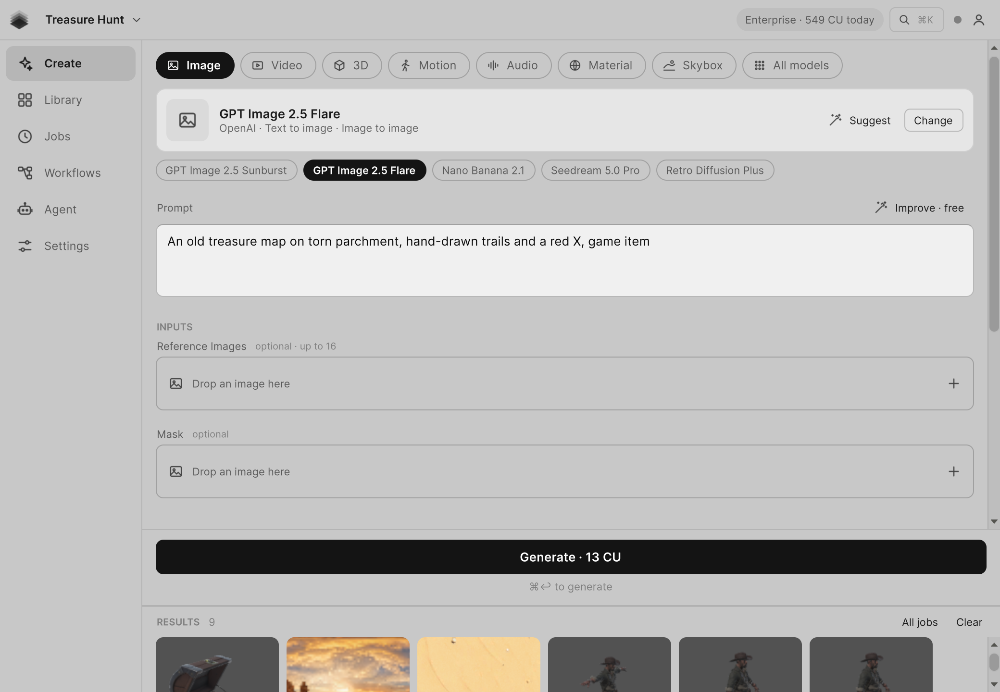

- **Navigation**: Create, Library, Jobs, Workflows, Agent, Settings. Above 560 px wide it shows labels.
- **Header**: the project, the plan, the command palette (Ctrl+K, Cmd+K on macOS) and the account menu.
- **Output types**: Image, Video, 3D, Motion, Audio, Material, Skybox, All models. A type sets the model filter, the quick picks and how the result lands. **All models** reaches the whole catalog.
- **Model card**: the current model. **Suggest** shows Scenario's recommended models for the type; **Change** opens the model browser.
- **Prompt**: **Improve** rewrites it for the model with Prompt Spark, priced first. Undo on the notice brings your words back.
- **Inputs**: one slot per file the model takes. Drag from the Project window or the Hierarchy, or use **+**: the selection, a capture of the Scene view or the main camera, a file, or a Scenario asset. Files are uploaded once, for free.
- **Settings**: the essentials first; **More settings** opens the rest. Fields that change the price are marked.
- **Generate**: the price, and the line above it says where the result goes, for example "Places on Player (SpriteRenderer)".
- **Results**: one card per generation. **Place in the scene**, **Next** for its steps, and under **More**: Show in Project, Use as input, Use settings, Import again, Open on Scenario.

### Choose a model

| Model browser | Command palette |
| --- | --- |
| 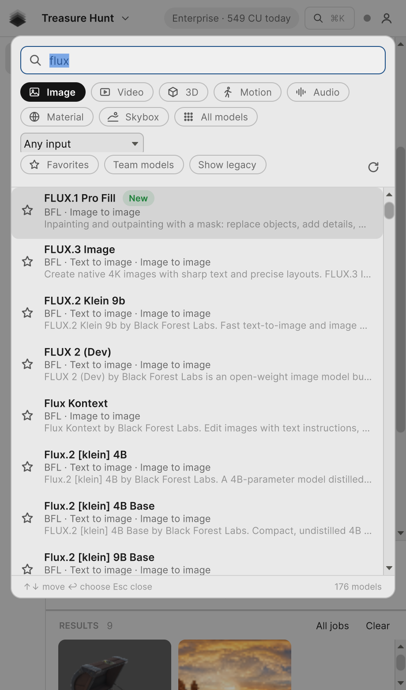 | 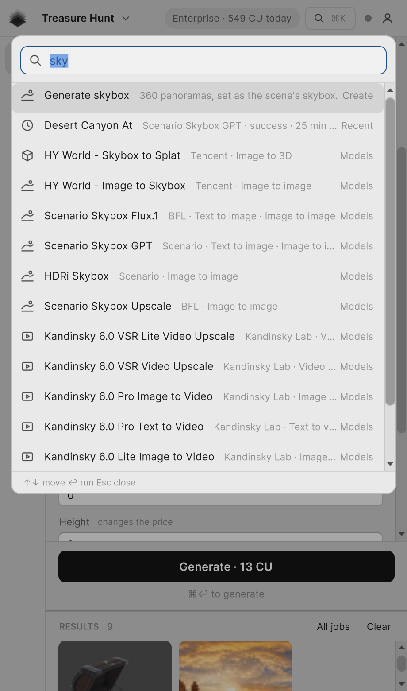 |

The model browser searches by name, with Favorites, Team models and legacy models on demand; a star pins a model to your favorites. Your team's trained models are there too. The command palette lists every action, model, recent job and the steps for the selection.

## Prices and spending

- **Price first.** The button shows the price of the exact request, from a free check. Change anything and it is checked again.
- **One click, one paid request.** A paid request is never sent twice.
- **Confirmation** above a limit, 1,000 CU by default (**Settings > Spending**).
- **Spending off** in **Settings** stops every paid request from this editor. Prices, browsing and imports still work.
- **Unknown** means the connection dropped while a paid request was being sent. The same request then waits until the job is found on Scenario, so a network error cannot charge you twice.
- A request stopped by content moderation shows as **Blocked** and is never resent.

## Jobs

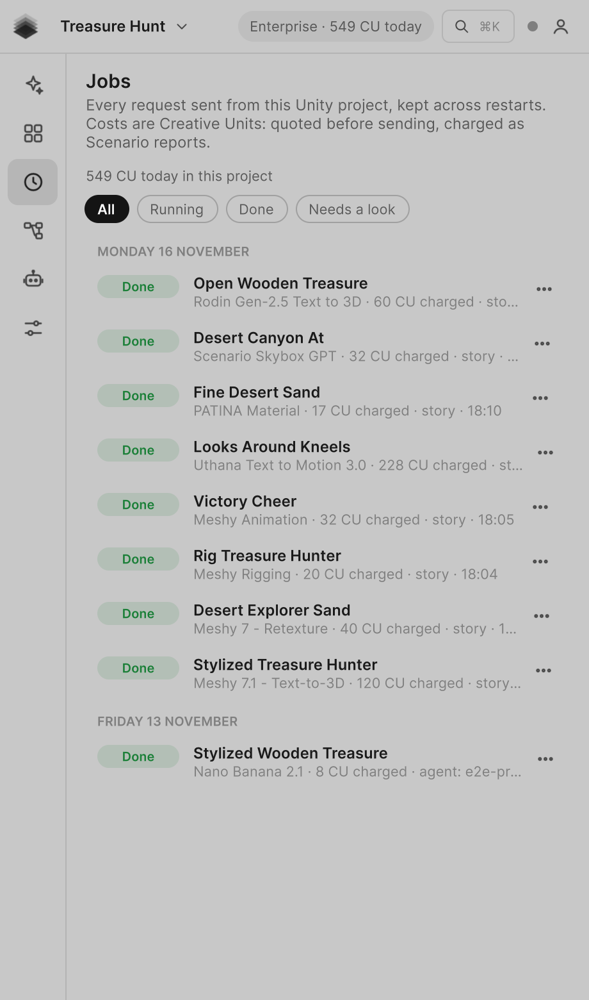

| State | Meaning |
| --- | --- |
| Sending | being sent |
| Queued, Running | accepted by Scenario |
| Done | finished and imported |
| Failed | Scenario reported an error; the message is on the row |
| Blocked | stopped by content moderation; never resent |
| Canceled | canceled by you |
| Not sent | refused before sending, for example without a fresh price |
| Unknown | the connection dropped while sending: it may or may not have started |

For an **Unknown** job, wait a minute, then **Look for it on Scenario**. Do not generate the same request again until it is resolved. The list is kept on your machine and survives restarts.

## Library and workflows

| Library | Workflows |
| --- | --- |
| 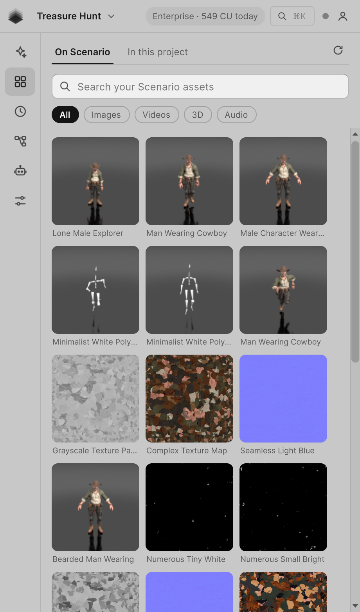 | 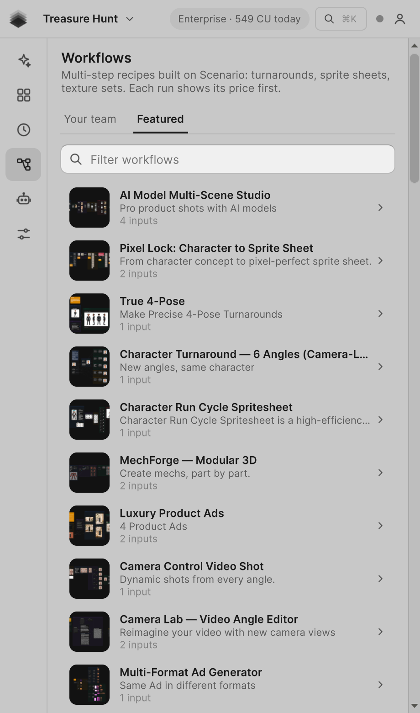 |

**Library > Scenario** lists the assets of your Scenario project, newest first, by kind or by a search: **Import**, **Import and place**, **Use as input**, **Next**. **In this project** lists everything in this Unity project that came from Scenario.

**Workflows** lists your team's Scenario workflows and the featured ones. Open one to see its inputs as a form, with its price; **Run** sends it like any generation.

## Where results go

- Files go to `Assets/Scenario/<Type>/<date>/`, named after the prompt. Change the folder in **Settings > Output**, or right-click a folder and choose **Scenario > Generate Here…**.
- Images import as textures, or as sprites in 2D projects. 3D models import as prefabs. Materials are built for your render pipeline. Skyboxes are set in the scene's lighting; with HDRP, the window says what to set in your Volume.
- Animated results get an Animator Controller next to the file.
- Gaussian splats are saved as `.ply` or `.spz` files, not placed: Unity needs a splat renderer package to show them.
- Each generated asset keeps its model, prompt, settings and price, shown in its Inspector with **Use settings**, **Next** and **Open on Scenario**. The record follows the asset when you move or rename it.

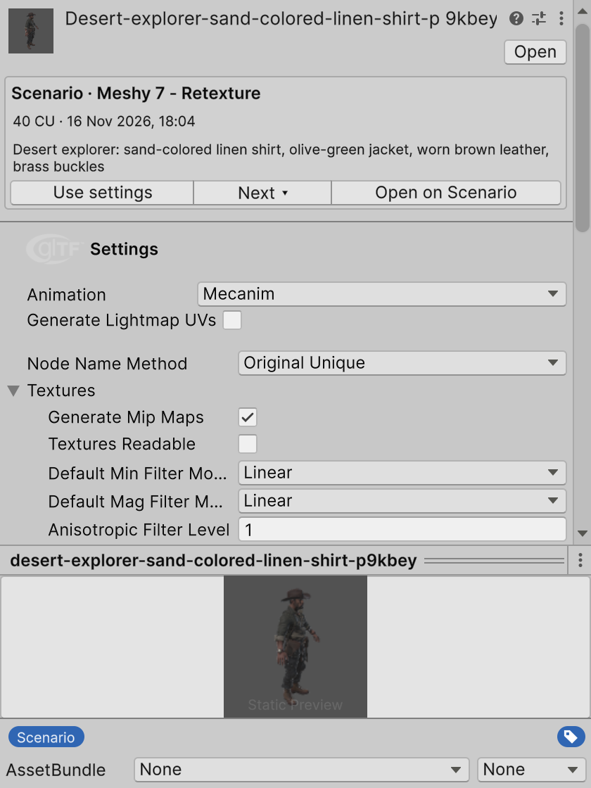

## Settings

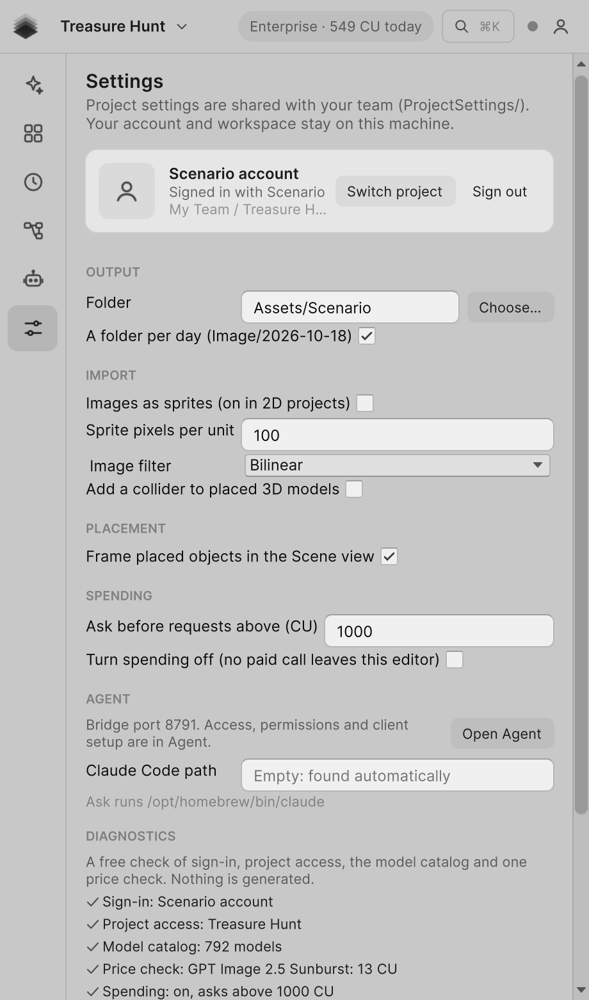

- **Output**: the folder, and daily subfolders.
- **Import**: images as sprites, colliders on placed models.
- **Spending**: the confirmation limit; spending off for this editor.
- **Agent**: the Claude Code that Ask runs.
- **Diagnostics**: a free check of sign-in, project access, the catalog and a price. **Copy the report** for a support request.

Output, import, placement and the confirmation limit are saved with the project and shared with your team. Your account, favorites, the spending switch and the agent settings stay on your machine.

## What leaves your machine

- **To Scenario**: your sign-in, your requests (prompts, settings, the files you attach) and the downloads of your results.
- **To your agent**: when you use **Ask**, your request and the names of what you selected go to Claude Code, under your own Claude account.
- **Nothing else.** The plugin sends no usage data. The agent bridge answers only on this machine, and only to clients that have its token.

## Troubleshooting

- **"Price unavailable"**: the form has a value the model refuses, or Scenario did not answer. The message under the button says which. Run **Settings > Diagnostics**.
- **Generate stays disabled**: the price is being checked, a required input is empty, an upload is in progress, or spending is off. The button says which.
- **"Needs an input" on a motion model**: Cartwheel animates a character you give it. Add a 3D model, or an image of one.
- **An animated model does not move**: animations play in Play mode.
- **The model did not land on my object**: select the object before generating, or use **Place** on the card afterwards.
- **A job is Unknown**: wait a minute, then **Look for it on Scenario** on its card.
- **The agent cannot connect**: check that the Agent switch is on and the dot is green, and that the client has the current setup. After **Regenerate**, copy the setup again.
- **Ask says Claude Code was not found**: install it, or set its path in **Settings > Agent**. "Not signed in": run `claude` once in a terminal.
- **The Scenario panel is gone from the Scene view**: tick **Scenario** in the Scene view's Overlays menu.
- **Nothing shows after a script compile**: close and reopen the window. Jobs and results are kept.

Still stuck? Write to support@scenario.com with the report from **Settings > Diagnostics**.

## Known limits

- Tested on macOS. Windows and Linux are expected to work but are not tested yet.
- Tested with URP and the Built-in render pipeline; HDRP is not tested yet.
- Animations import as Generic clips for the character they were made for: a motion made for one character does not play on another yet.
- Gaussian splats are saved but not shown.
- **Sign in on another device** is not available yet.
- The header shows your plan and what this editor spent today, not your balance.
